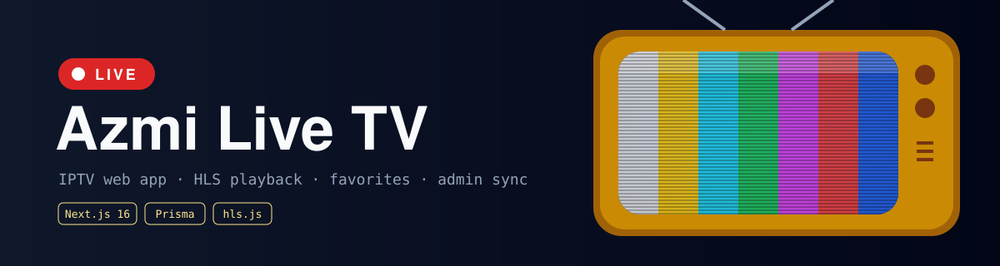

<p align="center">
  
</p>

# Azmi Live TV

A full-stack Next.js IPTV web app with:

- Username/password authentication (JWT cookie session)
- Role-based authorization (`ADMIN` and `USER`)
- Live channel browser with search, filter, and favorites
- HLS playback support in browsers (via `hls.js`)
- Admin panel with manual **Refresh / Check Sync** button
- GitHub source sync from `Channels_data.json`
- Sync logs and repository sync status tracking

## Main Features

- Login page with secure session cookie (`httpOnly`)
- Dashboard with:
	- live player
	- channel list and search
	- group filtering
	- favorites toggle
- Admin panel with:
	- repository status cards
	- refresh sync button
	- force sync button
	- user creation form
	- user list

## Tech Stack

- Next.js 16 (App Router)
- TypeScript
- Prisma ORM
- PostgreSQL
- Tailwind CSS v4
- JWT (`jose`) + password hashing (`bcryptjs`)

## Environment Setup

Copy `.env.example` to `.env` and fill values:

```bash
cp .env.example .env
```

Required variables:

- `DATABASE_URL`
- `NEXT_PUBLIC_SUPABASE_URL`
- `NEXT_PUBLIC_SUPABASE_ANON_KEY`
- `NEXT_PUBLIC_SUPABASE_PUBLISHABLE_KEY`
- `JWT_SECRET`
- `ADMIN_BOOTSTRAP_USERNAME`
- `ADMIN_BOOTSTRAP_PASSWORD`

Supabase / Vercel Postgres helpers (optional but recommended for clarity):

- `POSTGRES_DATABASE`
- `POSTGRES_HOST`
- `POSTGRES_PASSWORD`
- `POSTGRES_PRISMA_URL`
- `POSTGRES_URL`

Set `DATABASE_URL` to your Supabase pooler URL (usually same as `POSTGRES_PRISMA_URL`).

Repository sync variables:

- `SYNC_REPO_OWNER`
- `SYNC_REPO_NAME`
- `SYNC_REPO_BRANCH`

Optional:

- `GITHUB_TOKEN` (recommended to reduce API rate-limit issues)

## Local Development

Install dependencies:

```bash
npm install
```

Generate Prisma client and push schema:

```bash
npm run prisma:generate
npm run prisma:push
```

Run development server:

```bash
npm run dev
```

Open:

- `http://localhost:3000/login`

Use bootstrap admin credentials from your `.env` to sign in.

## Vercel Deployment

This project is Vercel-ready.

1. Push this repository to GitHub.
2. Import in Vercel.
3. Add all environment variables in Vercel Project Settings.
4. Use a managed Postgres database (Neon, Supabase, Vercel Postgres, etc.).
5. Run a schema push/migration against production DB:

```bash
npm run prisma:generate
npm run prisma:push
```

## API Overview

Auth:

- `POST /api/auth/login`
- `POST /api/auth/logout`
- `GET /api/auth/me`
- `POST /api/auth/register` (admin only)

Channels / favorites:

- `GET /api/channels`
- `GET /api/favorites`
- `POST /api/favorites`
- `DELETE /api/favorites`

Admin:

- `GET /api/admin/status`
- `POST /api/admin/sync`
- `GET /api/admin/users`

## Notes

- Sync imports channels from `Channels_data.json`.
- Existing channels from sync source that disappear are marked inactive.
- Admin sync button checks latest Git commit SHA first, then updates only when needed (unless force sync is used).
